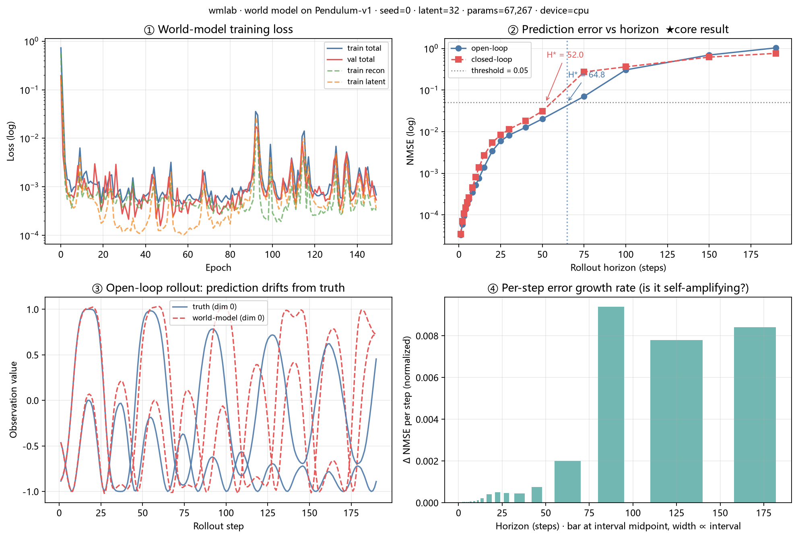
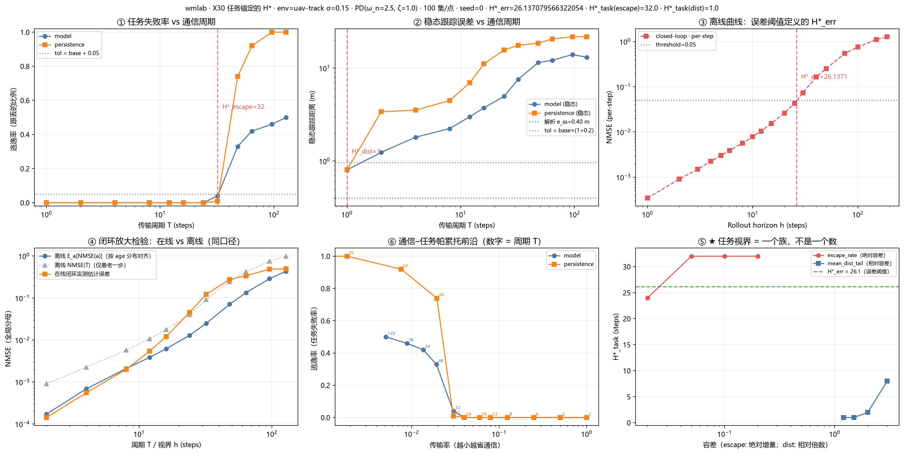
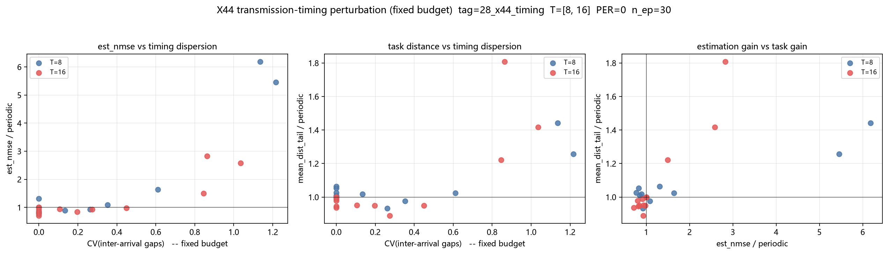
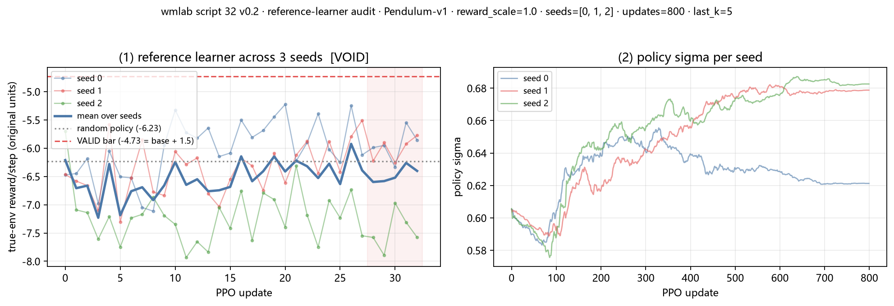

# world-model-lab

> 世界模型 + rollout + 可靠视界评测的最小可复现框架。
> 场景锚点：**UAV / 无线通信**（本框架先用 CartPole 级任务把训练循环跑通，再换场景，只动 `wmlab/envs/`）。

## 这个仓库解决什么问题

世界模型（world model）在 rollout 到第 N 步之后会失准。**本仓库不主张"这个现象没人研究过"** ——
它主张的是把「**第几步开始不准、为什么、值不值得预测**」做成一套**可测量、可复现、可对比**的
最小口径，并且**把口径本身写死进代码**：同一个 H\* 在不同口径下能给出 6 个"都对"的数值
（见 §设计约定 7）—— 口径不明示的比较，本仓库一律不认。

- 统一的环境接口（`envs`），换场景不改模型与评测代码
- 最小的世界模型实现（`models`），编码器 + 潜空间转移 + 解码器
- 潜空间 rollout（`rollout`），支持任意视界
- **可靠视界（reliable horizon）**定义与测量（`eval`）——**第 h 步自身**的预测误差
  首次超过阈值的那一步（"逐点"口径；用累积口径会系统性抬高 H\*，见 §设计约定 7）
- **通信接入层**（`envs/channel.py`）——把世界模型接到丢包/时延信道 + AoI 记账；
  ★ **不要**把 H\* 直接当发送周期：X25 已证 H\* 与**最优传输间隔不是同一个数**（差 2.4 倍，
  按 H\* 传会**过度通信**）⇒ H\* 只给"误差容忍度"，决策量是帕累托拐点（见 §④）
- **时延地板**（`eval/tracking.py`）——时延**真的延迟**信息之后，误差多出一个
  **与模型无关的下界** `2(1 − ρ_o(D))`（X27）：这是"生成年龄 ≠ 传输年龄"的实测证据

## 快速开始

```bash
# 1) 环境（本机已建好 ai-lab，见项目文档）
conda activate D:\devtools\miniconda3\envs\ai-lab
# 或在 VSCode 里直接用任务：Terminal -> Run Task -> wmlab: 环境自检

# 2) 环境自检（15 项，含中文字体链路）
python scripts/00_check_env.py

# 3) 随机策略 baseline，产出第一张图
python scripts/01_random_baseline.py

# 4) 训练一个世界模型，产出 loss 曲线 + 多步预测误差曲线
python scripts/02_train_world_model.py

# 5) 分析误差增长的形态（饱和 / 线性累积 / 自我放大，三选一）
python scripts/03_analyze_horizon_curve.py outputs/02_world_model_pendulum.json

# 6) 通信接入：X24 等价性 + X25 调度帕累托 + X26 解析对账（约 3 min，全程 CPU）
python scripts/04_channel_tracking.py --config configs/channel.yaml
python scripts/04_channel_tracking.py --config configs/channel.yaml --quick   # 冒烟

# 7) X26 对账细节（离线曲线 vs 在线实测、插值敏感性、H* 两口径）—— 读 04 的产物，不重训
python scripts/05_diagnose_x26_gap.py

# 8) X27 时延地板（读 04 的 checkpoint，不重训；约 1–2 min）
python scripts/06_delay_floor.py --quick   # 冒烟：2 条 × 200 步
python scripts/06_delay_floor.py

# 9) X3/X4：种子重复 × 阈值敏感性（CPU，约 13 min；含 5 次完整重训）
python scripts/07_seeds_threshold.py --quick            # 冒烟：2 种子、小 epoch
python scripts/07_seeds_threshold.py --seeds 0 1 2 3 4

# 10) 自检（89 项，不依赖 pytest；每个用例对应一次真实踩过的坑；★ 圈码 1–50 用尽后改用 [nn]）
python tests/test_channel_and_aoi.py

# 11) X22：C17 的 safe horizon 在本场景**能不能实证**（12 项断言，秒级；不训练、不需 GPU）
python scripts/08_x22_theory_check.py

# 12) X30：任务锚定的 H*（UAV 闭环控制，约 2 min CPU；误差阈值 vs 任务失败的比值）
python scripts/16_task_horizon.py

# 13) X9：想象训练（Pendulum，连续动作；世界模型 + 三档视界想象臂 + 真实 PPO 对照，约 6 min CPU）
python scripts/31_x9_imagination.py

# 14) 参照学习器审计 v0.3：给定配置下"真实 PPO 到底会不会学"
#     默认 3 种子 × 800 轮 = 1,228,800 环境步（约 10 min CPU）；冒烟：--updates 10 --seeds 0
#     ★ 判定（单一真源 wmlab/eval/audit.py）= **每一个种子**的「末 5 次评测均值」都 ≥ 随机基线 + margin（默认 1.5/步）
#     ★ 配对评测：随机基线与 PPO 用**同一批固定初值种子**；差值按**逐回合配对**算；随机动作走独立 RNG
#     ★ Pearson r 只做**诊断**（形状量：快速学会后长期平台会把 r 压低 ⇒ 不当门槛）
#     ★ VOID ⇒ 基于它的 A/B 比较作废，**不是**"方法无效"
python scripts/32_reference_learner_audit.py

# 15) ★ 六族调度**统一最小闭环**（交付阶段）：六族共用一条闭环（同 env/模型/控制器/预算/种子）
#     + 统一结果表 + 等预算配对；校准集与评测集 seed 不相交（K3）
#     ★ 接线验收（可证伪）：W1 AoI 递推 / W2 送达⇒U=0 / W3 送达⇒真值误差=0 / W4 首查询 age=0
#       —— `state.reads` 只证明"读过字段"，W1–W4 才证明"值在正确时点"
#     ★ `--mode both` 另做「用统一 runner 逐位重现 X44」（判据：最大 |Δ| ≤ 1e-9）
python scripts/33_unified_closed_loop.py --mode both          # 约 12–18 min CPU
python scripts/33_unified_closed_loop.py --mode table --quick # 冒烟：六族表（秒级）

# 16) ★ 限时 PPO 诊断（§㉚）：用**成熟实现**（stable-baselines3 2.9.0）作**诊断参照**，
#     把「参照臂学不动」的归属钉到**超参**上 —— 同一任务 / 同一评测初值（500000..500009）/
#     同一环境步预算（409,600 步 / 臂）。★ 对照**只用于定位，不用于宣称算法优劣**。
#     ★ 我们自己的臂**不重跑**：直接读 scripts/32 的机器产物（R7：能机器数的绝不手记）
#     ★ `--reuse-sb3-json`：配置 / 训练种子 / 评测初值 / 预算**逐项相同**才复用，否则重算
#     ★ 5 配置 × 3 种子 × 409,600 步 ≈ 40 min CPU；冒烟 `--smoke`（秒级）
python scripts/34_ppo_diagnosis.py --smoke
python scripts/34_ppo_diagnosis.py --sb3-configs aligned,default,ab_nsteps,ab_epochs,ab_ent
```

# 17) ★ 多用户资源层（T8–T12）：N 个用户竞争同一份**帧预算**，成功概率由"派给谁"决定
#     T8 接口契约（wmlab/eval/multiuser.py 的模块 docstring：信息集 / 预算 / 五类记账 / 不变量）
#     T9 E1=N=1 逐位回归（3 种子 hex 相同）、N=2 冒烟、SINRSuccess（q(csi)=exp(-κ/csi)）
#     T12 四臂 × 两档预算 × 3 种子 × 30 集（uav + cartpole，AR(1) 异质链路），CPU ~13 s
#     ★ 定长窗口 + 终止吸收代价（window_cost）：**早死必须更贵**，尾均值会把它算便宜
#     ★ 四个臂只在 alive 用户里选：派给死人的份额空转会令"各臂可用预算"不等
python scripts/39_t9_e1_n1_regression.py     # N=1 逐位回归（护栏，改口径不许破它）
python scripts/40_t9_n2_smoke.py             # N=2 记账冒烟（含 I6 空转反例）
python scripts/41_t9_sinr_success_n1_regression.py
python scripts/43_t9_fix_abc_selfcheck.py    # 信息边界 / 死亡记账 / 终止代价，24 条
python scripts/44_t13_lookahead_selfcheck.py # 前瞻臂 12 条（H=1 逐位回归 / H=3 暴力对照 / 解析视界 / 接线守卫）
python scripts/42_t12_hetero_four_arms.py    # 五臂 × 两档 × 3 种子（产物见 results/）
python scripts/45_t14_horizon_arms.py        # 视界 H∈{1,5,20} × 两档 × 3 种子（99 s）
python scripts/46_t14_failure_timescale.py   # 断服失效时间尺度（诊断，非判据）
python scripts/51_p0_results_io_selfcheck.py # 入库唯一入口 26 条（拒绝覆盖/备份/INDEX/接线，全在临时目录）
python scripts/52_t21_paced_matching_ablation.py --skip-experiment  # 配速包装器 7 条（含 B=L 恒等 / 裸臂 t>B=0 两条阴性对照）
python scripts/53_t22_predictor_timing.py --skip-zoh-regression     # 三种预测的时序/信息集 8 组（不带 S2 时 <1 s；带 S2 = 36 cell 逐位回归 44 s）
```

> **入库规则（2026-10-19 T20 / P0-3）**：脚本**不得**自己拼 `results/` 路径，一律走
> `wmlab/eval/results_io.py`。证据写 `results/runs/<run_id>/<name>.json`（同名再写 ⇒ exit 3，
> 除非 `--allow-overwrite`，且会先备份 `.bak.<时间戳>`）；自检快照写 `results/selfcheck/`
> （判定不变则不重写）；`results/INDEX.md` 由代码生成，标 `current` / `superseded` / `v1(frozen)`。

# 18) ★ T13 `lookahead`（期望 1 步前瞻）——**负结果，已归档**
#     ⚠ **2026-10-19 T20 标签降级**：结论限于「**完美动力学 + 未来必达(q=1) + 单步**」这个替代评估器；
#       不得推广成"前瞻类信号无用"。见 `04-实验与代码/2026-10-19-T20-H3标签降级与H2H4边界说明.md` §2
#     结论：geo = 1.080 / 1.050（两档），两档都打不过 `max-age`（0.944 / 0.801）
#     原因（可证）：CartPole 代价是 0/1 阈值函数 ⇒ 1 步 rollout 的代价差**恒为 0**
#     （实测 cart_gain = 0.00e+00，6000 次决策 0 正 0 负）⇒ 臂必然恒选 UAV = max-channel
#     ⇒ 见 04-实验与代码/2026-10-19-T13-lookahead结果-v0.1.md §2；下一假设 H3 = 视界 H∈{5,20}

# 19) ★ T14 多步前瞻（H=1/5/20）——**负结果，已归档**：视界不是瓶颈
#     ⚠ **2026-10-19 T20 标签降级**：「视界不是瓶颈」→「**当前近似前瞻**（反事实里 q=1、不扣预算、
#       按 `max-age` 续接）**未达门槛**」。该反事实评估的是乐观续接的替代系统，不是受限链路的 H 步价值函数
#       ⇒ **不得**写"长视界无用""视界不是瓶颈""前瞻策略族不可达"。见
#       `04-实验与代码/2026-10-19-T20-H3标签降级与H2H4边界说明.md` §1（每个数字指到 JSON 的哪一格）
#     cart_gain(H) = 0.0000 / 0.0128 / 0.0296（H=1/5/20；门槛 0.1·s_cart = 0.0956）
#     geo(H=20) = 1.041 / 1.015，仍差于 `max-age`（0.944 / 0.801）
#     ★ 机制（scripts/46 实测）：CartPole 断服中位 10 步（≤20 步 100%）⇒ H=20 **已覆盖**失效窗口；
#       UAV 恒定 53 步（≤20 步 0%）⇒ 要覆盖它得 H≥53，但那是另一个假设，不是本轮判据的补救
#     ★ 真正的短板是**目标函数**：`age` 把 CartPole 的送达间隔压在中位 3 步（0.5% ≥10 步），
#       `la20` 拉到中位 6 步（22% ≥10 步）⇒ 逐步边际价值在此系统上系统性低估"脆弱任务"的需求
#     ⚠ **2026-10-19 T15 更正**：上面这条推论**不成立** —— 中位 3 步 / 0.5% 说明 `max-age` 本身
#       **没有**违反 CartPole 的失效窗口（D=10 步），"饿坏"的是 `la20` 而不是基线。
#       原句把"某臂的病理"当成了"基线的病理"，据此设的 H4 注定只能小赢（实测 −0.008/−0.033）。
#       原文保留不删（只追加更正），见 `04-实验与代码/2026-10-19-T15-归一化年龄结果-v0.1.md` §3.1
#     ⇒ 见 04-实验与代码/2026-10-19-T14-多步前瞻视界结果-v0.1.md；下一假设 H4 = 归一化年龄/约束式分配

# 20) ★ T15 归一化年龄 `argmax age_i/D_i`（D = 实测失效窗口 53/10）——**负结果，已归档**
#     ⚠ **2026-10-19 T20 标签降级**：结论限于「**两用户 + 离线常数 D + 静态权重**」的本实现
#       （稳态下 `age_i/D_i` ⇔ 静态频率比）；**不能**证伪"带在线 deadline 估计的约束型调度"。
#       见 `04-实验与代码/2026-10-19-T20-H3标签降级与H2H4边界说明.md` §3
#     geo = 0.936 / 0.769（B=100/200），两档都只比 `max-age`（0.944 / 0.801）好 −0.008 / −0.033
#     B=100 仍 > GATE 0.90，且该档 r_uav = 1.155（比 rr 差 15.5%）⇒ **H4 否证**
#     ★ `D` 的取值确实起作用：交换 D=(10,53) 的对照臂 geo = 1.020 / 1.008（差于 age +0.076/+0.206）
#     ★★ 但它**不是约束算法**：稳态下 age_i/D_i 相等 ⇔ rate_i ∝ 1/D_i ⇒ 实质是权重 (1/53,1/10) 的
#        静态频率比；实测 CartPole 最大间隔 10.7 / 11.0 步 **仍 > D=10** ⇒ 约束没被守住
#     ★★★ H4 的立论前提被自己的数据推翻：`max-age` 本来就把间隔压在中位 3 步（≥10 步仅 0.5%），
#        "饿坏脆弱任务"的是 `la20`（22% ≥10 步），不是 `max-age`
#     ⇒ 见 04-实验与代码/2026-10-19-T15-归一化年龄结果-v0.1.md；
#       下一问**不再是策略**，而是可行性：B=100 档 0.90 到底可不可达（4 臂最好 0.936）

# 21) ★ T16 配额 + 配速（`QuotaPacing`）——**先修了一个记账缺陷，再判 H5**
#     ★★ 前置事实（读代码 + 实测）：`_exhausted` + 所有臂"只要 alive 就派帧" ⇒ 第 t 步累计已用 = t
#        ⇒ **B=100 时 t=100 预算归零，窗内后 100 步零发帧**（3 种子实测 `t>100` 发帧数恒 0）
#        ⇒ 之前 B=100 的所有数字都混着"后半段断服"，不能当策略能力上限读
#     ★ 量化：同样 100 次发帧，铺满 200 步 vs 在 t≤100 花光 ⇒ J_uav **6.950 → 3.053 m（−56%）**、
#       UAV 存活 183.7 → 200.0 步。差别只在**分布**，不在帧数
#     ★★ 但这是**交易不是修复**：全部分割里 `r_cart ≥ 1.004`、`r_uav ≥ 0.440`，
#       **没有任何一点让两个用户同时变好**；geo ≤ 0.90 只能靠把 CartPole 推差 9–23% 换 UAV
#       ⇒ B=100 geo* = 0.720 但 max r = 1.177 > 1.10 ⇒ 预注册判 **DEGENERATE（不算通过）**
#     ★★ 机制：两个任务要**相反**的调度 —— CartPole 存活是速率的陡函数（速率 0→9.9 步、0.5→44.7、
#       1.0→124.2 步），且这条曲线**两个预算几乎重合**（决定它的是速率不是档位）；
#       UAV 失效窗口 53 步，要全程稀。B=100 的速率上限只有 0.5 ⇒ CartPole 连活过半个窗口都做不到
#     ★ 附带更正：T15 "绑定变量是预算档"这一句要下调 —— 同速率下两档几乎重合，
#       绑定变量是**速率与时序**，档位只是速率的代理
#     ⇒ 见 04-实验与代码/2026-10-19-T16-配额配速结果-v0.1.md；
#       下一假设 H6：①`PacedAdaptive`（闸门=速率、选人=age/D）②换问题：用模型跨陈旧预测（对着主线 H*）
#
# 22) ★ T21 配速化匹配消融（`Paced`）——**B=100 的旧排序被打翻**
#     做法：`Paced(arm, B, L)` = `allowance(t)=floor(B·t/L)`，放行 ⇔ `allowance−used ≥ 1`；
#       **选谁完全交给原臂**（view 原样转交，逐字段核对）⇒ 只改时序，不改选择
#     ★★ B=100：三配对 geo 差值**全部反向**（rr–age +0.056→−0.013；rr–na +0.064→−0.122；
#       age–na +0.008→−0.109）⇒ `age` 1.013、`na` 1.122，**都不再优于 rr（1.000）**
#       ⇒ 「B=100 上 `age`/`na` 更好」降级为**"只在非配速（前紧后松）协议下成立"**；旧数字不改
#     ★★ B=100 **两种协议都没有臂**同时满足 geo ≤ 0.90 与 max r_i ≤ 1.10 ⇒ 负结论更强了
#       （非配速最好 `na` 0.936 但 max r=1.155；配速最好 `age` 1.013）
#     ★ B=200 = L ⇒ 配速是 **no-op**（`served_idx` 与逐集 J **逐位相同**，S1）⇒ 该档历史从未受缺陷影响：
#       `age` 0.801 / `na` 0.769 在公平协议下成立（max r 0.990 / 1.043 ≤ 1.10）
#     ★ 机制：B=100 的绑定约束是**全局速率 0.5**（分摊后 CartPole ~0.25）⇒ 存活 44.9 → 21.8 步；
#       让 CartPole 活更久（`na` 37.1 步）必然让 UAV 退化 +37.9% ⇒ 只能记"交易"
#     ★ 配速对 `rr` 自身也是交易：J_uav 6.950 → 3.434 m（−50.6%）、UAV 存活 183.7 → 200.0 步，
#       但 J_cart 0.781 → 0.896（+14.7%）
#     ⚠ 边界：只测了一种配速时点（均匀铺开）、3 种子、未测预测臂；`Paced` **不是新算法**（token bucket）
#     ⇒ 见 04-实验与代码/2026-10-19-T21-配速化匹配消融-结果-v0.1.md；证据 `results/runs/…/52_*.json`
#
# 23) ★ T22 接收端预测器（`wmlab/eval/predictors.py`）——**先把"接得上"证掉，再说收益**
#     做法：`est`（控制器看到的状态）从"零阶保持"改为可替换的 `predictor`；
#       `ZOH`（保持）/ `Linear`（两次送达观测差分外推，**不用动作**）/ `TrueDyn`（`deepcopy` 环境 +
#       自己实际施加的动作前推，**诊断特权**）。信息集是签名的一部分：三者都**拿不到 `View`**
#     ★ 回归红线：`predictor=None` 与 `ZOH` **逐位相同**（S1）；`ZOH` 重跑 T21 的 **36 cell**，
#       逐 episode J 与 `results/52` **逐位相同**（S2，44 s）⇒ 新路径没有改变既有轨迹
#     ★ 信息集：`diagnostic=True/False` 下 `Linear` 轨迹**逐位相同**（S3）；`age≥2` 时分配器看到的
#       `last_obs` 仍是**送达值**（S9）⇒ 预测只喂控制器，**没有**免费给所有臂一条"预测真值"通道
#     ★ 时序：强制"送 2 帧→断服"，送达步误差 **精确 0**、t=3 仍为 0、此后严格增长（S5）；
#       `actions_since` 长度恒等于 `age`（差一步就会"预测错步数"）；动作逐项等于 `controller.act()`
#       的返回值、丢帧步照样入缓冲（S6）
#     ★ `TrueDyn` 在 `age≥1` 步误差**恒等于 0**（S4，精确 0，无容差；反对照 ZOH 中位 0.60）
#       ⇒ 影子确实在推演，不是静默退化成 ZOH；`TrueDyn` 的 0 误差是**环境确定性**的产物，不是模型好
#     ★ 影子不得污染主轨迹：换一个"照跑但丢输出"的 `ShadowOnly`，轨迹与 `predictor=None` 逐位相同（S7）
#     ⚠ **本轮不出收益表**（预注册 §0/§4）。接线冒烟（2 集 × 1 种子 × `age` 臂）里 J 有方向性差异
#       （ZOH 3.18/2.81 → Linear 0.94/1.09 → TrueDyn 0.39/0.39，逐用户 J_uav/J_cart），
#       但样本量与环境确定性都不支持任何结论 ⇒ **只当"接对了"的旁证**；收益表留 T23
#     ⚠ 边界：①下行理想（`est` 直接喂控制器）⇒ 本轮的"实际施加动作"≡"命令"，S6 验的是接线不是鲁棒性；
#       ②`Linear` **结构性地弱**（忽略控制动作，稳定控制器下必然过冲）⇒ 若 T23 出现 Linear 劣于 ZOH，
#       **不得**写成"预测无用"；预注册已冻结补救：T23 先加 `ARX`（`x⁺≈Ax+Ba`，在线 RLS）再下结论
#     ⇒ 预注册 04-实验与代码/2026-10-19-T22-三种预测-预注册-v0.1.md；结果 …-时序确认-v0.1.md
#
# 24) ★ T23-a 公平预测器 `ARX` + 两个机制分解诊断臂 —— **附带一个结构性发现：一步映射在本协议下不可辨识**
#     做法：`ARX`（`x⁺≈Ax+Ba+c`，递推正规方程 + **相对 ridge** `λ·diag(R)`；**只学 `gap==1` 的送达对**；
#       样本 < `2·dim` 时**显式退化**为 `Linear`，`describe()` 可见）；`LinearTargetOnly`/`LinearSelfOnly`
#       按**观测维度查表**切片（UAV 6 维：`[0:4]` 自身、`[4:6]` 目标；CartPole 4 维 ⇒ TargetOnly **≡ ZOH**）
#     ★ 正对照：合成线性系统 40 个 `gap==1` 对 ⇒ 一步预测相对误差 **6.2e-7**；把动作**打乱**再喂 ⇒ **1.01**
#       （比值 1.6e6×）⇒ 这条检查有分辨力，不是"恒真"（`scripts/54` A1/A2）
#     ★ 退化路径：3 < 2·3 样本时与 `Linear` **逐位相同**（A3a），且 `degraded_users` 显式可见（A3b）；
#       只喂 `gap==2` 的对 ⇒ `n_samples` 不增（A4，只计数 `gap_gt1`）
#     ★ 回归红线不变：`predictor=None` 仍与 `ZOH` 事件序列 + 逐集 J **逐位相同**（A7）；
#       T22 的 `scripts/53` 9 组仍全 PASS（含 36 cell 逐位回归，45.4 s）
#     ★★ **本轮最重要的发现（负结果，但可复算）**：在"1 帧/步、2 用户"协议下，**两用户都存活时**
#       同一用户的送达间隔恒 ≥ 2 步 ⇒ `gap==1` 的样本占比 **1.03%**（2/194，B=100 与 B=200 各 1 个）
#       ⇒ 一步 ARX **无法辨识**，全程停在退化态（A9b FAIL）。
#       对照：同一档用 ZOH 时 CartPole 在 t≈5 就倒，UAV 独占信道 ⇒ `gap==1` 占 **63%**
#       ——即"**只有某个任务已经失败的那条轨迹，才给得出一步辨识数据**"。这不是统计偶然，
#       是速率约束的算术后果（每用户服务率 ≤ 1/N ⇒ 间隔 ≥ N）。
#       ⇒ **调度策略决定了预测模型的可辨识性**，这正是主问题"预测补偿与调度如何协同"的一个硬耦合
#     ⚠ 因此 T23-b 的"四预测器收益表"**不能按原计划做**：ARX 在该协议下 ≡ Linear，无法用来排除
#       "弱预测器"解释。下一轮先预注册"分滞后阶线性模型组"（`M_g: x_{t+g}≈A_g x_t + B_g[a_{t+1..t+g}]`，
#       `g=2,3` 有样本）或改协议，**不得**在 T23-b 里把"ARX 退化"当成"ARX 也输了"
#     ⚠ 本轮**不出收益表**；A9c 的单集误差中位数（age≥1：ZOH 0.612/0.678 vs Linear 0.198/0.705）
#       与"ZOH 下 CartPole 5 步就倒"都只是**接线指纹**，1 集 0 种子，不得引用为收益
#     ⇒ 预注册 04-实验与代码/2026-10-19-T23a-ARX预测器-预注册-v0.1.md（含 §4b A1 阈值修正）
#       结果 …-T23a-ARX预测器-结果-v0.1.md；自检 `scripts/54_t23a_arx_predictor.py`（A1–A9d，不写文件）
#
# 25) ★ T23-a-2 分滞后阶模型组 `M_g` —— **ARX 的"没数据"问题解决了，但只解决了 2 阶**
#     做法：对每个滞后阶 `g∈{1..6}` 一套 `x_{k+g} ≈ A_g x_k + B_g[a_{k+1};…;a_{k+g}] + c_g`，
#       只学 `gap_prev==g` 的送达对；`n < F_g`（`F_g=dim+g·act_dim+1`）⇒ **该阶不启用**，整步退化为
#       `Linear`（逐位相同）；**混合 age 不拼装**（`age=5` 无 `M_5` 就走 `Linear`，不拼 2+3）。
#       接线唯一改动：送达时把**整段动作窗口** `action_seq`（长度 == `gap_prev`）交给预测器
#     ★ 正/反对照（合成 `gap=2`，40 对）：`rel_pred=1.7e-6`、`rel_A²=1.1e-5`、`rel_[AB,B]=1.6e-6`；
#       动作块打乱 ⇒ `0.575`（**3.4e5×**）⇒ 检查有分辨力（`scripts/55` B1/B2）
#     ★ 接线对账：记录侧与拟合侧的 `gap` 直方图**逐档相等**（u0/u1 × B=100/200 四组），
#       `seq_mismatch=0`、`seq_last_mismatch=0`（B6）
#     ★★ **覆盖率（这才是本轮的结论）**：`age≥1` 的决策点里真正用上 `M_d` 的比例
#       **B=200: 27.7%（75/271，过预注册 20% 门）｜B=100: 11.1%（21/190，不过门）**。
#       分年龄（B=200）：`age=1` **0%**（结构性，`g=1` 只有 1 个样本）、`age=2` **72.6%**、
#       `age=3` **52.6%**、`age≥4` **6.3%**。机制：样本被 6 个滞后阶摊薄，`F_g` 随 `g` 线性增长，
#       只有 `g=2`（27 对 ≥ F=11）与 `g=3`（19 ≥ 13）过线；`g=4` 要 15 对、实得 7 对 ⇒ 退化
#     ★ 预测误差（★ 非收益·非证据，闭环比）：B=200 的 `age=2–3` 上中位 L2 **0.0064（mlag） vs 0.4307（linear）**
#       ⇒ 学到的是真东西；`age=1` 上 ≡ `Linear`
#     ⚠ **不得**把 27.7% 写成"公平预测器已解决"：T23-b 若开，预测器须标
#       `hybrid(M_2,M_3 + Linear fallback)`，主表限 B=200，且收益要按 `age≤1 / 2–3 / ≥4` 分层报
#     ⇒ 预注册 04-实验与代码/2026-10-19-T23a2-分滞后阶模型-预注册-v0.1.md（含 §3.1b 阈值代验）
#       结果 …-T23a2-分滞后阶模型-结果-v0.1.md；自检 `scripts/55_t23a2_multilag_predictor.py`
#       （B1–B9 + B8c，不写 `results/`/`outputs/`；**B8@B=100 是 FAIL，属研究可行性门，不是程序错**）
#
# 26) ★★ T23-b 预测补偿收益表 —— **预测对 UAV 大幅有效、对 CartPole 必须先学对；而"误差更小"≠"代价更低"**
#     做法：同一调度（臂 `age`）、同预算、同初始信息，只换接收端预测器
#       `ZOH / Linear / hybrid(M_2,M_3+Linear) / TrueDyn(diagnostic)` × {unpaced,paced} × {B=100,200} × 3 种子
#       × 30 集 = **48 cell，81.9 s**（`scripts/56_t23b_compensation_benefit.py`）
#     ★ 主表（B=200 unpaced，`r_i = J_i(pred)/J_i(ZOH)` 同种子配对）：
#       `Linear` r=(0.313, 1.022) geo 0.564 ｜ `hybrid` r=(0.340, 0.843) geo 0.535 ｜
#       `TrueDyn` r=(0.134, 0.000) 【diagnostic，`J_cart=0` 是环境确定性的产物】
#     ★★ **本轮最硬的新事实：误差不能给预测器排序**（同一轮同一协议下的三个反例）
#       ① CartPole 上 `Linear` 误差比 `ZOH` **更差**（1.392 vs 0.713），代价却打平（1.022 vs 1）；
#       ② UAV 上 `hybrid` 误差更小（0.158 < 0.231）但 `J` **更差**（1.002 vs 0.921，+9%）；
#       ③ CartPole 上 `hybrid` 误差压到 0.011（**131×**），代价只改善 16%
#       ⇒ 与 X30–X36「NMSE 不能当任务代理」同一条，此处在预测补偿语境下复现
#     ★ 机制（`hybrid` vs `Linear`，只差 `age∈{2,3}` 这一支，两者在其余 age 上**同一函数**）：
#       r=(1.090, 0.827) ⇒ **UAV 差 9%、CartPole 好 17%**，方向相反 ⇒ 记「交易」不记「该层有收益」。
#       ⚠ CartPole 那 17% 混着帧数反馈（存活 2901→3433 步 ⇒ `age` 调度自然多给帧 1605→1901），
#       不能全部归因于预测补偿（R17 同源）
#     ⚠ **20% 覆盖率门在本轮实跑里没过**：合并覆盖率 B=200 **17.6%**（2998/17038）、
#       B=100 4.6%/7.9%；`age=2–3` 分档 44.3%。T23-a-2 的 27.7% 是**另一次运行**的数字
#       ⇒ **覆盖率是轨迹的函数，不是预测器的常数**；本轮结论只能写"在该覆盖率下"
#     ⚠ B=100 unpaced 预测让 UAV **变差 21%**（1.215/1.208）⇒ 该档是交易；`t>B` 发帧 0（断服）必须同报
#     ⚠ 3 种子只够筛选（`hybrid` 有 1/3 种子 CartPole 打平 1.013）⇒ 全部标**开发结果**
#     ⇒ 预注册 04-实验与代码/2026-10-20-T23b-补偿收益表-预注册-v0.1.md；结果 …-结果-v0.1.md
#       证据 `results/runs/20261020-004151-daacb33/56_t23b_compensation_benefit.json`
#       （前两版 `003551`/`003811` 因**标签写错**被 superseded；三次运行 48 cell 的 `J` **逐位相同**）
#
# 27) ★★ T24 共享 (A,B) 单模型 —— **覆盖率抬起来了，但收益更差：覆盖率是必要不充分条件**
#     做法：把逐阶 `M_g` 换成"所有 `g` 共用一套 `(A,B_j,c)`"
#       （`x_{k+g} ≈ A x_k + Σ_{j≤g} B_j a_{k+j} + c`，`max_gap=6`，`n<F_total` 落 `Linear`）
#       与 #26 **完全同一套协议**（`age` 臂 × {unpaced,paced} × {B=100,200} × 3 种子 × 30 集
#       = **48 cell，83.9 s**，`scripts/57_t24_shared_ab.py`）
#     ★ 覆盖率（本轮主指标，C6）：B=200 unpaced **65.7%**（11042/16816；新门 50% 过、旧门 20% 同时报也过）
#       vs T23-b 的 **17.6%**；★ **`age=1` 从结构性 0% → 68.9%**（共享 `B_1` 由**每一个**送达对贡献样本）
#       B=100 两模式 **30.5% / 47.0%，均未过 50% 门** ⇒ 该档覆盖率没抬起来
#     ★★ 但代价变差（B=200 unpaced 主表）：`shared` r=(0.920, 0.868) geo 0.892
#       vs `Linear` r=(0.313, 1.022) geo 0.564 ⇒ 匹配对照 `shared/Linear` = **(2.947, 0.852)**
#       逐种子 `r_uav` = 2.709 / 2.922 / 3.212（**三种子全 >1**）⇒ **UAV 差 195%、CartPole 好 15%**
#       ⚠ CartPole 那 15% 混着帧数反馈（`served` 1615→1863），不能单独归因预测（R17 同源）
#     ★★ 机制（本轮最硬的新事实）：**池化偏差会灌进共享参数本身**。真实 `g` 步映射里 `a_{k+1}` 的系数是
#       `A^{g-1}B`（随 `g` 变），共享口径把它写成同一个 `B_1` ⇒ `A`/`B_1` 被所有 `g` 的样本共同决定
#       ⇒ **连 `age=1` 都变差**（误差中位 0.1851 vs `Linear` 0.0832）。只有"拟合只见过 `gap==1`"时才精确
#       （合成 44 对纯 `gap=1` ⇒ 3.58e-06，动作块打乱 1.66，4.6e5×）
#       ⇒ 自证伪 #57：**「某参数在某个子集上无偏」不能推成「混合估计下它无偏」**
#     ★ 预注册否定条件（B=200 unpaced `r_uav ≥ 1.0`）**命中** ⇒ 按预注册**停止在该方向加模型复杂度，转 P3**；
#       P3 的候选方法用 `Linear`（同协议下 UAV −69%），不再用 `hybrid`/`shared`
#     ⇒ 预注册 04-实验与代码/2026-10-20-T24-共享AB单模型-预注册-v0.1.md；结果 …-结果-v0.1.md
#       证据 `results/runs/20261020-025036-62663b3/57_t24_shared_ab.json`（`checks_failed=[]`）
#
# 28) ★★★ P3-0 确认性评估 —— **`Linear` 的 UAV 收益在"没参与选择"的种子上复现（0.315，区间上界 0.337）；
#     而同一个预测器在断服档上会变毒（1.223）：预测补偿的安全边界由调度刷新率决定**
#     设计：方法在 T24 已冻结为 `Linear`（无可学参数）；确认种子 `{100,130,160}` × 30 集
#       ⇒ reset 初值 `100..189`，**90 个互不相同**、与开发集 `0..31` **零交集**（`scripts/58` 的 C5）
#       × {unpaced,paced} × {B=100,200} × 4 预测器 = **96 cell，184.6 s**
#     ★ 主表（B=200 unpaced，`t>B` 发帧恒 0）：`Linear` `R_uav`=**0.315**，cluster bootstrap 95%
#       **[0.295, 0.337]**（上界 <1）；逐种子 3/3 同向；逐 cluster **90/90** 改善；`J_uav` 2.944→0.927 m（−68.5%）
#       且 **UAV 拿到的帧更少**（`served` 4510→4368，−3.2%）⇒ 收益不可能来自多分帧
#       ★ 与开发集（T23-b）`R_uav` 0.313 对比 ⇒ **复现到 0.6%**（无参数可调，收益与种子无关）
#     ★★ CartPole 侧**不许写成"也变好"**：`R_cart` 0.921 但区间 **[0.821, 1.028] 含 1**、
#       逐 cluster 只有 **40%** 改善、逐集比值中位正好 **1.000**，且开发集同口径是 **1.022**（方向相反）
#       ⇒ 只能写"未超出预注册等价界 1.10，方向在 seed 集之间不稳定"
#     ★★★ 失配边界（同一预测器，只改时序）：B=100 **unpaced** `R_uav`=**1.223**（[1.167,1.279]，显著变差）
#       vs B=100 **paced**（帧铺满窗口，`t>B` 发帧 1500/cell）`R_uav`=**0.476**，差 2.6×
#       机制：断服后 `age` 无界增长，`Linear` 按末次速度**常数外推** ⇒ 误差随时间线性发散；`ZOH` 只冻结位置
#       ⇒ **"预测补偿"与"无线调度"必须协同的第一个直接证据**（v2 §一 主问题的那一半）
#     ★ C7 自检里抓到第 58 条自证伪：合成数据的"真值"写成 `0.8·lognormal(0,σ)`，
#       而 `lognormal(0,σ)` 均值是 `exp(σ²/2)>1` ⇒ 真值其实是 0.816/0.850，覆盖率假性掉到 0.80
#       ⇒ 固化"写合成数据判据先按分布算期望代验真值"
#     ⇒ 预注册 04-实验与代码/2026-10-20-P3-0-确认评估-预注册-v0.1.md；结果 …-结果-v0.1.md
#       证据 `results/runs/20261020-050355-613f4be/58_p3_confirmation.json`（`checks_failed=[]`）
#
# [T19] 2026-10-19 · P0 修正（不是新实验，是把证据链本身修到可信）
#     ★ 原子锁：旧版"先 status 再 write" + 全局共享 `.run.id` ⇒ **无分辨力**。实测对照：
#       旧逻辑无人工间隙 3 轮全"通过"，插入 20 ms 间隙后 8/8 进程同时"拿到"同一把锁
#       ⇒ 新实现改 `O_CREAT|O_EXCL` + 每持有者独立 token（锁内只存 sha256）+ 接管守卫
#     ★ 元数据说谎：`scripts/42` 写 `absorbed=[0,1]`、计算用 `[25,1]`。已改同源常量，
#       重跑后逐 episode 逐用户 1800 个数**逐位相同（max|Δ|=0）** ⇒ 纯元数据错误，数值未污染
#     ★ NaN 能过区间检查（`(nan<0)|(nan>1)` 恒 False）⇒ 已加 `isfinite` 拦截；预热末态
#       `last_obs`/`cost_est` 已同步到 `est`（当前无臂读这两字段，故数值仍不变）
#     ⇒ 见 04-实验与代码/2026-10-19-T19-P0修正-文件.md；`scripts/49`（29 检查）、`scripts/50`（9 检查）

换环境只换配置，代码不动（长视界那轮就是这么做控制变量的）：

```bash
python scripts/02_train_world_model.py --config configs/pendulum.yaml --tag 02_world_model_pendulum
```

所有结果图写入 `outputs/`（不进版本库）。

## 目录结构

```
wmlab/
  envs/     环境适配层。统一接口，换 UAV/信道场景只加 Adapter
  models/   世界模型。编码器 / 潜空间转移 / 解码器
  rollout/  潜空间多步 rollout，以及误差随视界增长的测量
  eval/     指标：NMSE、可靠视界、预测区间覆盖率
  utils/    设备选择（CPU/云 GPU 无痛切换）、随机种子、统一绘图样式
scripts/    可直接运行的入口脚本（编号即依赖顺序；00 = 环境自检）
configs/    YAML 配置（device: auto 时自动选 cuda 或 cpu）
outputs/    ★ 结果图与日志，已 gitignore
results/    ★ 需要**外部可核验**的小体积汇总（逐 episode J / 判据输出），**入库**
```

> ★ 为什么要有 `results/`：`outputs/` 被 gitignore ⇒ 只放在那里的数字别人复核不了。
> `results/` 只放"小到能进库、又足以重算结论"的汇总（逐 episode、逐用户），全量原始表仍在 `outputs/`。

## 设计约定（为云 GPU 迁移服务）

1. **设备无关**：任何 `.to(...)` 都走 `wmlab.utils.device.get_device()`，代码里不出现硬编码 `.cuda()`。
   本机无独显（CPU 起步），云端租 GPU 后 `--device cuda` 即可，不改代码。
2. **种子固定**：`set_seed()` 统一设置 python / numpy / torch，保证曲线可复现。
3. **配置外置**：超参走 `configs/*.yaml`，不写死在脚本里，便于扫参。
4. **结果落盘**：所有图与指标写 `outputs/`，README 里引用的图都从它来。
5. **样式随代码走**：中文字体由 `wmlab.utils.plot.apply_style()` 显式设置（探测
   YaHei / PingFang / Noto CJK 等并逐个回退），**不依赖 `MPLCONFIGDIR` 等进程环境**——
   换机器、换终端、上云，图里中文都不会变方块；负号渲染同步修复。
6. **依赖锁定**：`requirements.lock.txt` 是**最小可复现锁**（6 个直接依赖 + 21 个传递依赖
   = 27 个包，由干净隔离 venv 实测导出，torch 为 +cpu 版）；上云时只替换 torch 那一行为
   对应 CUDA 版本即可，代码不动。
7. ★ **口径必须显式**（2026-09-20 立）：任何"误差"数字都要写清三件事 ——
   **逐点还是累积**、**在哪个评测集上**、**除以哪个方差**。原因不抽象：H\* 这一个指标，
   在同一个 Pendulum 模型上就出现过 `64.83 / 51.96 / 42.99 / 39.01 / 25.71 / 25.57`
   六个数，全部"正确"，只是口径不同。代码层面已做成默认安全：
   `multi_step_error_curve()` / `closed_loop_error_curve()` **同时返回两个口径**；
   `reliable_horizon(..., calibration="cumulative")` 会**发警告**；
   `NmseCurve` 在 lengths 不匹配时**直接抛错**（而不是静默截断）。
8. ★ **报 H\* 还要写第四件事：种子数与滑窗采样数**（2026-09-20 X3/X4 补）。
   H\* 是"首次穿越"，属于曲线的极值泛函，对**种子**和**采样量**都比曲线本身敏感得多：
   5 个种子的 H\* 落在 **13.13 – 42.99**（CV **0.42**）；`n_samples` 从 256 提到 4096
   又会系统性挪动它。所以 `reliable_horizon` 的输入是"一条曲线"，而**一条曲线本身也不够** ——
   ⇒ 正确形式是 `H* = 26.9 ± 11.4 (5 seeds, n_samples=4096, θ=0.05)`
   或直接报对 θ 的**幂律标度** `α`（那个在均值上是稳的）。
   ★ **`±` 的含义**：跨 5 个种子的**样本标准差（1σ）**，**不是**标准误、也不是置信区间。
   ★ 报 H\* 还须同时标**曲线定义**：本仓库默认是**开环** rollout 的"预测误差首次穿越"；
   **开环 / 观测闭环 / 潜闭环 三者不等价**（见 §③ 与 R1）—— 换定义，数值随即改变。
   ★ 推论：**`NaN`/`Inf` 不得静默通过** —— `NaN <= 阈值` 恒为 False，
   会被当成"已超阈"返回**虚假偏小**的 H\*（实测触发过：弱模型观测空间闭环第 131 步后爆到 3.9e34）。
   现在会直接 `raise ValueError`。

## 四张图看懂这个仓库

**① H\* 是什么，它长成什么样**（Pendulum，视界到 190）



实线 = 逐点口径（H\* 的定义口径），淡虚线 = 累积口径；两者的间距就是「口径选择」本身的影响力
（累积口径会系统性抬高 H\* +33–51%）。
★ **H\* 是「首次穿越」类极值泛函，单点值不可引用** —— 5 种子下 `H*(开环) = 26.9 ± 11.4`，极差 3.3 倍。

**② 误差阈值 ≠ 任务边界**（X30，UAV 闭环控制）



同一个模型：误差阈值只给出**一个数**（`H*_err = 26.1`），但任务失败阈值在
**1–32 步之间漂移（32 倍）**，而且误差阈值恰好落在「灾难性失败」一侧。
⇒ 「用 NMSE 代表任务表现」这件事，在本仓库已被**三个独立场景反复否定**。

**③ 估计质量与任务收益是强衰减耦合**（X44，固定预算、只动发送时刻）



估计误差最多 **+518%**，任务指标只动 **+44%**（衰减 2.3–12 倍）；预算轴上更极端：
`est_nmse` **×1119** 只换来距离 **×2.97**，而且**非单调**。
⇒ 在本场景里，**继续优化估计 / 换触发统计量不是瓶颈**（条件性结论，见完整文档）。

**④ 先证明参照有效，再比较方法**（X9 想象训练 + 脚本 32 参照学习器审计）



X9（想象训练）跑出的是一张「全员平坦」的曲线 —— **但对照臂（真实 PPO）自己也没过随机线**
⇒ 这次 A/B 比较**没有分辨力**。结论只能写 **「参照失效 ⇒ 比较作废（VOID）」**，
**不能**写「想象训练无效（NEGATIVE）」。
★ 2026-10-12 修完 GAE 边界与 log-prob 后按**多种子**重跑（3 种子 × 800 轮 = **1,228,800** 环境步）；
随后**收口评测链路**（判定单一真源 + 真配对评测 + 随机源全受控）**再重跑一次** —— 新口径：
末 5 次均值 **−6.449 ± 0.983** vs 门槛 **−5.159**（随机基线 **−6.659**），**过线 0/3**，
配对差值（同初值逐回合）**−0.92 / +0.74 / +0.82** ⇒ **方向仍不一致，仍判 VOID**
（旧口径给出 −6.47 ± 0.86 vs −4.73；**两版数字不可混引**）。
★★ 所以：**修 bug 是"正确性"的修复，不是"性能"的修复** —— 参照臂过不过线得**另找原因**。
★ 且下面这条只是**候选假设**（不是已证结论）：已排除的是**几处实现缺陷**，
**不等于**"实现已无问题"；下一个候选 = 观测/奖励归一化 + 超参，**未逐行定位**
（见 [`docs/EXPERIMENTS.md`](docs/EXPERIMENTS.md) §㉘）。★ 那次（修 bug 后）重跑另有一条实质增量：三种子的 **best** 分别是
**−5.23 / −5.51 / −5.70**（离散度 **0.24**）而 **last** 是 **−5.85 / −5.77 / −7.58**
（离散度 **1.02**）⇒ **末次单点的方差是峰值方差的 4.3 倍**，"末次当判据"的噪声比它想测的信号还大。
★ 这条把「**本仓库跑 A/B 前，先证明基线自己过了随机线**」固化成可复跑工具
（[`scripts/32_reference_learner_audit.py`](scripts/32_reference_learner_audit.py)）——
**范围限于本仓库**，不是"一切 A/B 比较的普适规则"。

## 结论速览（最短版；每条都带条件）

> 这里只放**承重结论**，不放推导与数据。
> 每条的判据、计算口径与「⚠ 引用必带」在[完整实验史](docs/EXPERIMENTS.md)。

| # | 结论 | 关键数字 | 实验 |
|---|---|---|---|
| 1 | 世界模型的多步误差是**饱和**，不是自我放大 | 每步增量峰值在 h≈88，之后回撤 17%（开环）/ 63%（闭环） | X1 / X2 |
| 2 | 开环 / 观测闭环 / 潜闭环 **三者不等价**，H\* 随定义改变 | 两条曲线在 h≈100–150 交叉 | X1 / X2 |
| 3 | **H\* 不能当发送周期**：它只给「误差容忍度」，决策量是帕累托拐点 | 拐点间隔 62.5 步 vs H\*=25.6（差 **2.4 倍**）；按 H\* 传 = 过度通信 | X24 / X25 |
| 4 | **生成年龄 ≠ 传输年龄**：时延带来**与模型无关**的误差地板 | `2(1 − ρ_o(D))`，两条独立路径验证 | X27 |
| 5 | 平均丢包率相同（p̄=50%）时，**突发结构可使跟踪误差跨 570 倍** | 闭式 `E[NMSE]=p̄[f(L)+J]` 中位偏差 −1.5% | X31 |
| 6 | **NMSE 不能当任务代理**（跨 3 个独立场景复现） | Spearman(NMSE,距离)=0.778<0.8；argmin T 只一致 12/20；X44 差三个数量级 | X35 / X38 / X44 |
| 7 | 误差阈值 ≠ 任务边界；闭环控制会**把估计误差放大 ~1.7×** | H\*_task 在 1–32 步漂移（32 倍） | X30 |
| 8 | 模型自报不确定度 U **只是 age 的替身**（同方差环境） | 给定 age 后 ρ_cond=−0.029、AUC_cond=0.419；异方差 amp=4 时才 +0.347 | X38–X40 |
| 9 | 「**误差类**触发量」这一族**在本场景到顶也赢不了年龄阈值** | oracle 两臂距离比中位 0.9921 / 1.0023（零发散） | X43 |
| 10 | 估计收益 → 任务收益**强衰减**；瓶颈在任务侧而非触发量 | 估计 +518% / 任务 +44%；预算轴 ×1119 / ×2.97 | X44 |
| 11 | **A/B 方法比较前必须先验证参照学习器有效性**（否则实验只能判 VOID，不能判 NEGATIVE） | 参照臂 3 种子末 5 次均值 **−6.449 ± 0.983** vs 门槛 **−5.159**（1,228,800 步；过线 0/3；配对差值方向不一致）⇒ **VOID** | X9 / 脚本 32 |
| 12 | ★ **六族调度进同一条闭环后，用同一 runner 能逐位重现 X44**；且估计增益仍大于任务增益 | X44 重现 27/27 行 **最大 \|Δ\| = 0**（≤1e-9）；同一批配对上 `oracle`（★特权·不可部署）估计比 **0.78** vs 任务比 **0.88** ⇒ 亚线性衰减 ≈0.5 | 脚本 33 |
| 13 | ★ **参照臂"学不动"的归属 = 超参，不是算法族、也不只是自实现**（用成熟实现 SB3 作诊断参照定位） | 同一任务/评测初值/预算下：**SB3 用我方超参 0/3**、**出厂超参 3/3**；单旋钮消融 ⇒ `n_steps` 512→2048 或 `n_epochs` 4→10 **各自独立充分**，`ent_coef` **不是主因** | 脚本 34 |

★ 上表里**负面与收窄的结论一并报**：本仓库累计的 **35 次自证伪**全部保留在完整文档里
（包括被自己的实验推翻的跑前假设）。
★ 第 11 条是本仓库**唯一一条"元方法"结论** —— 它不是关于现象的结论，而是关于
「**本仓库怎么才算一次可信的 A/B 比较**」的纪律。★ 它的适用范围**限于本仓库**：
「跑前先证明参照臂自己会学」是这条纪律，但它**不是**"一切 A/B 比较的普适规则"
（2026-10-12 收窄 —— 别的项目不一定需要照搬，本仓库曾把它写成通用规则，属过度扩张）。
对**模型评测**类岗位，它比任何一条现象级结论都更直接。
★ 第 12 条的**引用必带**：`n_ep=12`、单 seed、`PER∈{0,0.3}`；`timing` 族在本设定下
**不可评估**（速率跨度 1.00×）；`oracle` 比值与 §㉔ 的 **0.9921 不可直接比**（设置不同，
幅度差异**未归因**）。

## 诚实的限制（引用前必读）

1. **跨环境数字不可比**。CartPole 与 Pendulum 的 H\* 不能直接比（状态维度 / 动作空间 / 每集长度都不同）。
2. **模型很小、任务很低维**。模型是 MLP（参数约 6.7 万），环境是 Pendulum / CartPole / 一个简化 UAV 闭环。
   **本仓库没有多模态基础世界模型，也没有真机部署**。
3. **H\* 的数值同时依赖四个字段**：口径（逐点/累积）、曲线定义（开环/观测闭环/潜闭环）、
   评测集与归一化分母、种子数与采样量。**四个一起写才能引用**。
4. **「误差类触发量这条路到此为止」是条件性结论**：它只在**本场景 + 本任务指标 + 本预算口径**下成立
   （X43 / X44）。**oracle 是诊断用的特权信息基线，不主张为性能上界**；
   **未观察到可分辨的任务收益 ≠ 收益严格为零**。
5. **尚未回答「该不该预测」这个科研问题**。本仓库回答的是「第几步开始不准、为什么、值不值」。
6. **想象训练（latent rollout 训 actor-critic）尚未被验证有效**：X9 已跑通（代码 + 曲线齐全），
   但**参照臂（真实 PPO）在本配置下自己没过随机线**（2026-10-12 修完 GAE 边界 / log-prob 后按
   3 种子重跑；**收口评测链路后**再重跑一次，末 5 次均值 **−6.449 ± 0.983** vs 门槛 **−5.159**，
   过线 **0/3**，**仍判 VOID**）⇒ 该实验
   **只能判 VOID**。**本仓库当前不能声称"想象训练有用"或"没用"**。
   ★ **参照臂学不动的根因仍是待检验假设**：已**排除**几处**实现缺陷**（GAE 边界 / log-prob 常数），
   但**这不等于**"实现已无问题"；下一个**候选**是观测/奖励归一化与超参，**未逐行定位**。
7. **本机（工位机）无 NVIDIA 独显**，全部结果为 **CPU**。

## 文档地图

| 你想知道 | 去哪 |
|---|---|
| 完整实验史（§①–㉘）、当前状态清单、结果图索引、参考定义 | [`docs/EXPERIMENTS.md`](docs/EXPERIMENTS.md) |
| 每个编号的预写判据 / 结算 / 更正说明 | 父项目 `04-实验与代码/实验记录/` |
| 怎么跑起来（环境、自检、缓存复现） | [`docs/REPRODUCE.md`](docs/REPRODUCE.md) |
| 调度基线库的统一接口 | [`wmlab/eval/scheduling.py`](wmlab/eval/scheduling.py) |

★ 判据：**不进版本库的图不算对外可验证的产出**（`outputs/` 已 gitignore）。
